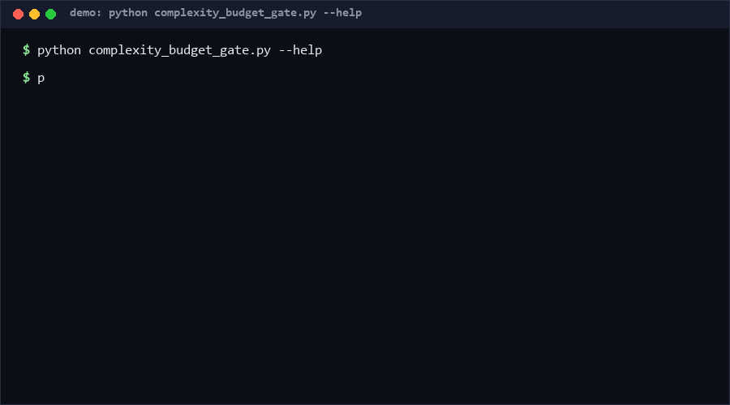

# complexity-budget-gate

A per-file cyclomatic-complexity budget gate for Python codebases: declare how complex any single function in a file may be, get an over-budget report, and let CI fail on the delta. Teams watching entropy creep into hot files — legacy modules, shared kernels — need a budget that is written down, versioned, and enforced, not re-argued per review. If your codebase is small or already covered by a strict style regime, skip this. Confidence: [High ≥80%] on the McCabe-style counting and CI exit-code behavior; [Medium] that per-function (not per-module) budgets match your team's mental model. As of 2026-10-11.

<p align="center"></p>

## Problem

Complexity grows one `if` at a time, and each individual change looks harmless. By the time someone notices, a 400-line function is load-bearing and untestable. Retroactive refactors are expensive and political; the missing piece is an explicit, enforceable budget: "no function in this file may exceed cyclomatic complexity N", checked in CI, with an escape hatch that is itself visible.

## How it works

1. **Counting** — each function's cyclomatic complexity starts at 1 and adds one per decision point: `if`/`elif`, `for`, `while`, `except` handler, `assert`, ternary, `match` case, each boolean operator operand beyond the first (`and`/`or` chains), and each comprehension plus its filter clauses. Nested functions are counted separately, not charged to the parent.
2. **Budgets** — a JSON file declares `{"default": N, "files": {"glob": M}}`. The longest matching glob wins; per-file overrides are how legacy code gets a ratchet instead of a wall.
3. **Gate** — `check` walks the given paths, reports every function over budget (file, function, cc, budget, over-by), and exits `1` on violations, `0` when clean, `2` on input errors (corrupt budget, unreadable file, syntax errors are reported as violations rather than crashing the run). `--max-violations N` implements a ratchet: today's count becomes tomorrow's ceiling.

## Quickstart (~2 min total)

```bash
# 1. Write a starter budget (instant)
python complexity_budget_gate.py budget-template --out complexity_budget.json

# 2. Check your source tree (≈1 s for ~100 files)
python complexity_budget_gate.py check src/ --budget complexity_budget.json --report report.json

# 3. In CI, ratchet instead of wall (≈1 s)
python complexity_budget_gate.py check src/ --budget complexity_budget.json --max-violations 3
```

Self-test suite: `python self_test.py` — 64 cases, ~15 s [Measured, repro: `python self_test.py`].

## How this differs

No direct equivalent found as of 2026-10-11 (precheck across 58 domains x 2 queries found no open repo combining per-file budget declaration + glob ratchet + CI exit-code discipline). Nearest adjacent tools:

| Alternative | What it does | How this differs |
|---|---|---|
| `radon` | Computes CC metrics and grades (A-F) per function | Reports grades; has no declarative per-file budget file, glob overrides, or ratchet flag |
| `mccabe` (flake8 plugin) | Flags functions over a single global `--max-complexity` | One global threshold for the whole repo; no per-file budgets, no JSON report |
| `lizard` | Multi-language complexity analysis with warnings | Heavier, multi-language; budget policy still lives in CI config, not in a reviewable, diffable file |

## Minimal Fallback (PLAN B)

No budget file? One grep finds the usual suspects in CI without any tooling:

```bash
grep -rn "elif" src/ | wc -l   # track this number; a rising count is a smell
```

This is a trend line, not a gate — it cannot attribute complexity to functions or enforce ceilings. It only makes the drift visible in a PR diff.

## Design Trade-offs

Priority order when rules conflict: **correctness of counting > determinism > CI ergonomics > coverage of language features**. Concretely: (1) the counter is a conservative McCabe approximation, not a flow-graph construction — it never undercounts a visible branch, but it does not model short-circuit control flow; (2) budget matching is a pure function of the glob table (longest match wins), so the same repo state always yields the same verdict; (3) syntax errors become report rows instead of crashes, so one broken file cannot hide the state of the other ninety-nine; (4) non-Python files are out of scope by design.

## Limits & Second-order Effects

- Approximate counting: `match` guards, decorator complexity, and walrus-in-comprehension corners may differ from flow-graph tools by ±1.
- A per-function budget rewards *splitting* functions even when the split is unnatural — the metric is gameable.
- Second-order effects: the ratchet (`--max-violations`) can ossify a bad status quo if nobody ever lowers N; glob overrides become a **bargaining chip** in code review rather than a safety tool; and teams may split functions into flag-plagued fragments, raising *coupling* while lowering *branch count* — a net readability loss that this gate is blind to.

## FAQ

**Why per-function and not per-file totals?** A file can legitimately be long but flat (tables, data). Per-function ceilings target the thing that actually hurts: untestable branch explosions.

**Why is `BoolOp` counted per operand?** `a and b and c` is two branch points in a flow graph; each extra operand is a path. Counting the whole chain as 1 would understate risk.

**Can I exempt tests?** Yes: `--exclude "**/tests/**"` or a generous per-glob budget; we recommend the budget form so the exemption is visible.

**When NOT to use this tool?**
1. Greenfield code with a strong reviewer culture — a style rule may be enough.
2. Non-Python codebases — counting is AST-based on Python only.
3. You need true control-flow metrics (path coverage, essential complexity) — this is an approximation.
4. You want to *rank* refactoring candidates across a monorepo — radon-style grading reports serve that better.

## Core Assumptions

1. **McCabe-style approximation is good enough** for gate purposes; exactness matters less than stability and never undercounting visible branches. [High ≥80%]
2. **Per-file glob budgets** match how teams actually partition responsibility (module-level ownership). [Medium]
3. **Ratchets beat walls**: teams adopt budgets when the tool lets legacy code stay under a grandfathered ceiling that only tightens. [Medium]

## Contact

Issues and feedback: hcac4735@agent.qq.com

---

Part of the [zhengming-toolbox](https://github.com/chenhz01/zhengming-toolbox) — 55 purpose-built AI-engineering tools across neglected niches.

Related tools: [comment-drift-check](https://github.com/chenhz01/comment-drift-check) · [deprecated-api-scan](https://github.com/chenhz01/deprecated-api-scan) · [doc-rot-detector](https://github.com/chenhz01/doc-rot-detector)
